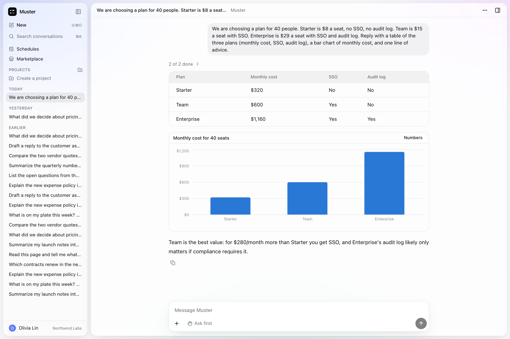
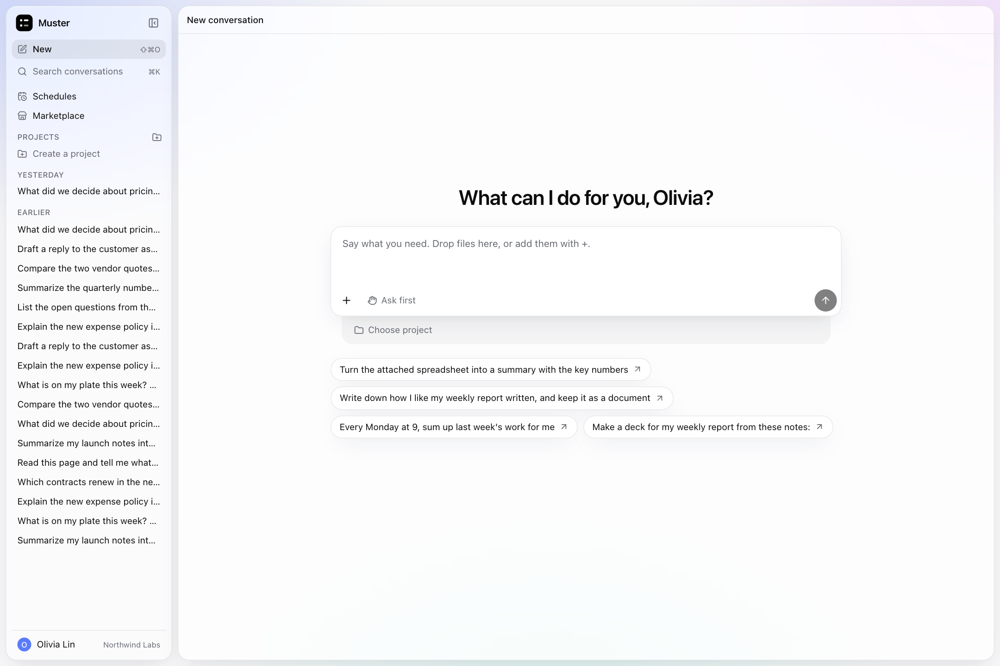
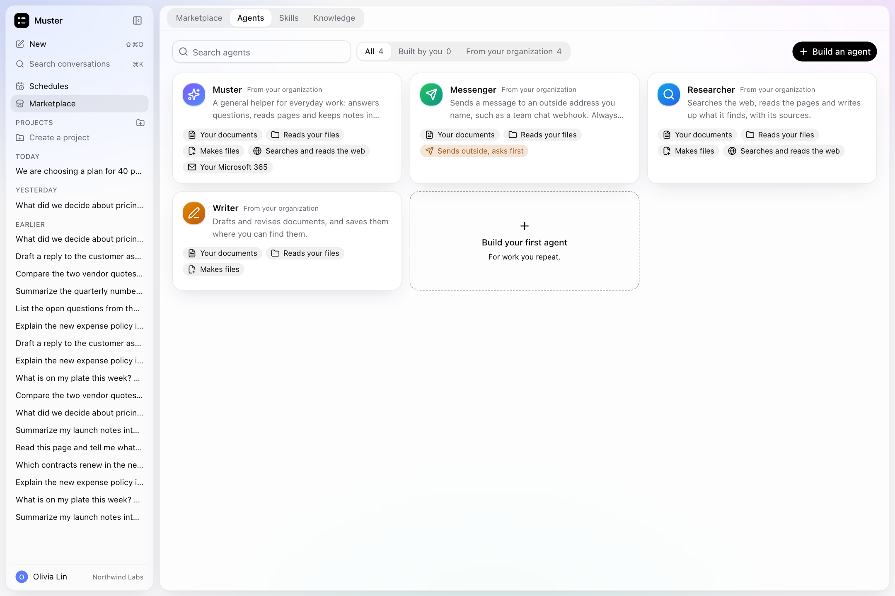
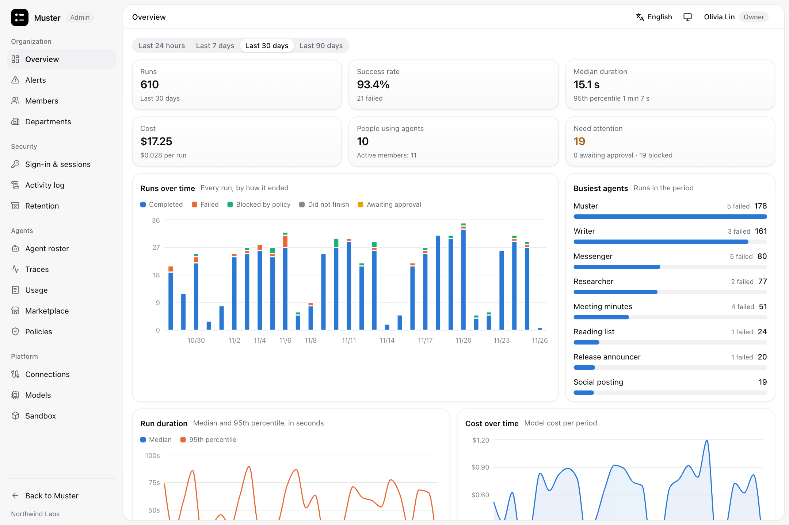
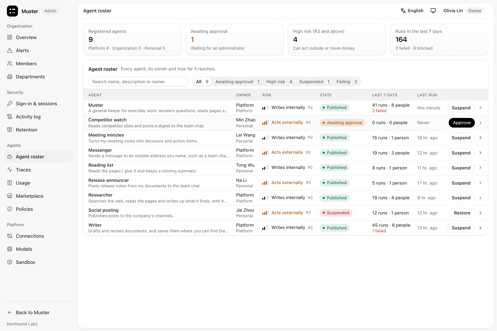
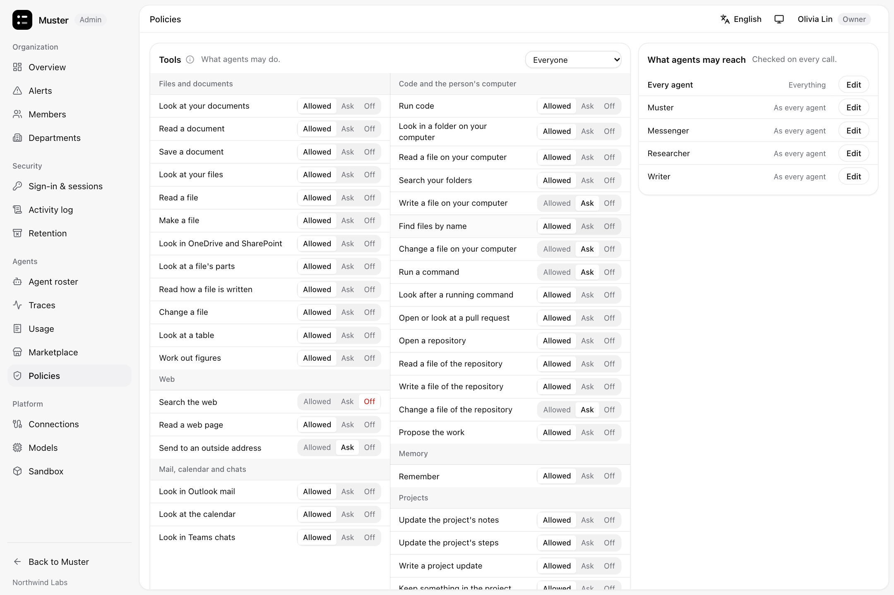
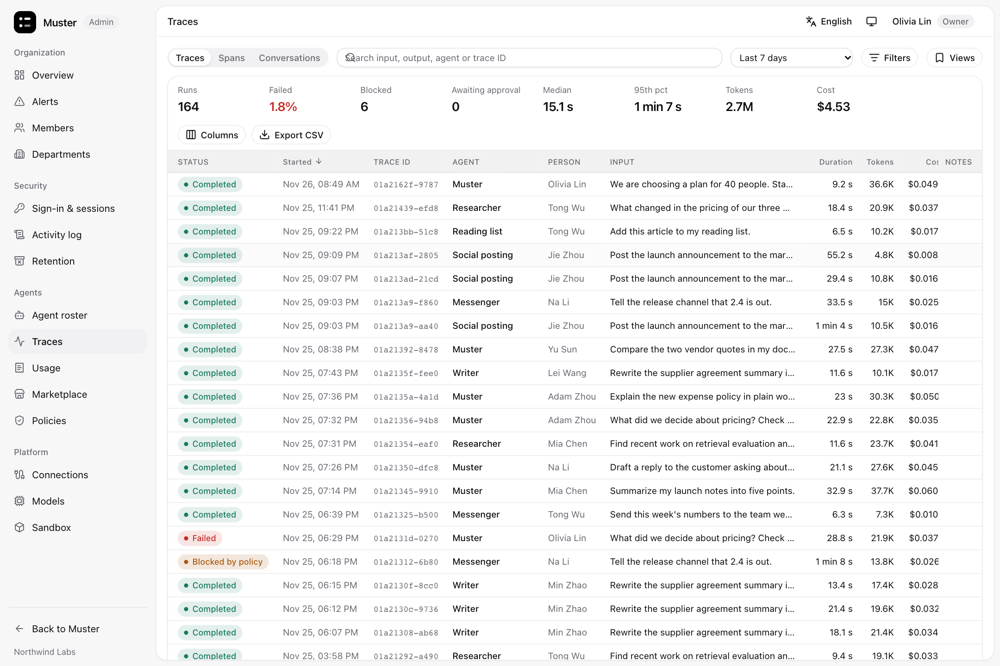
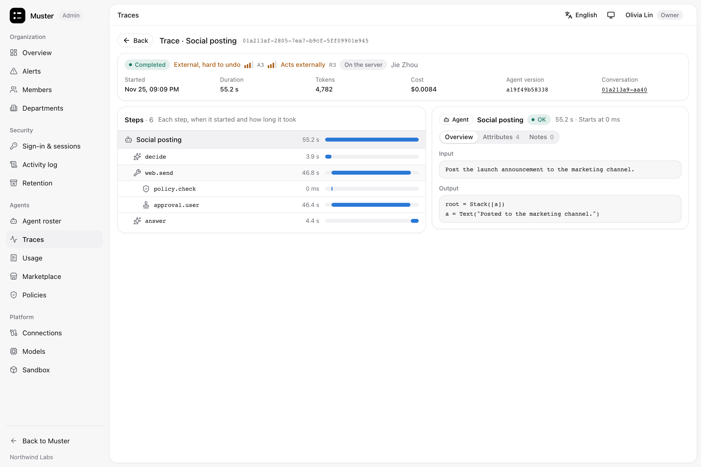
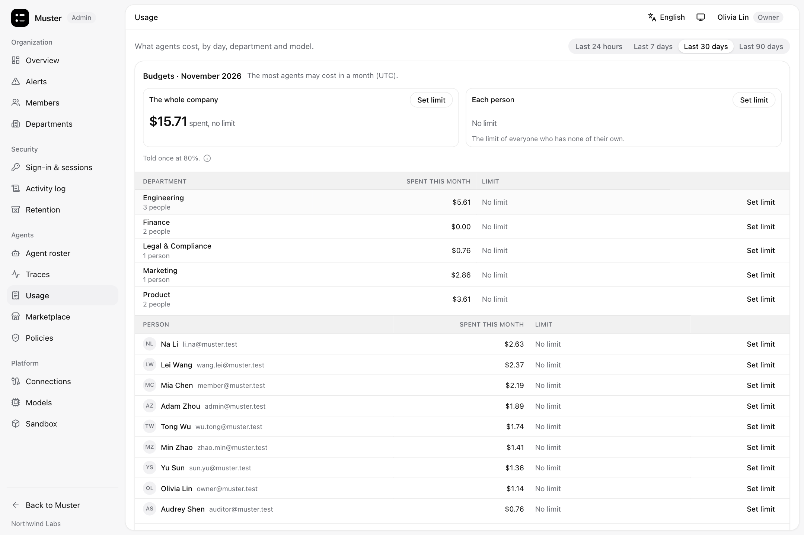
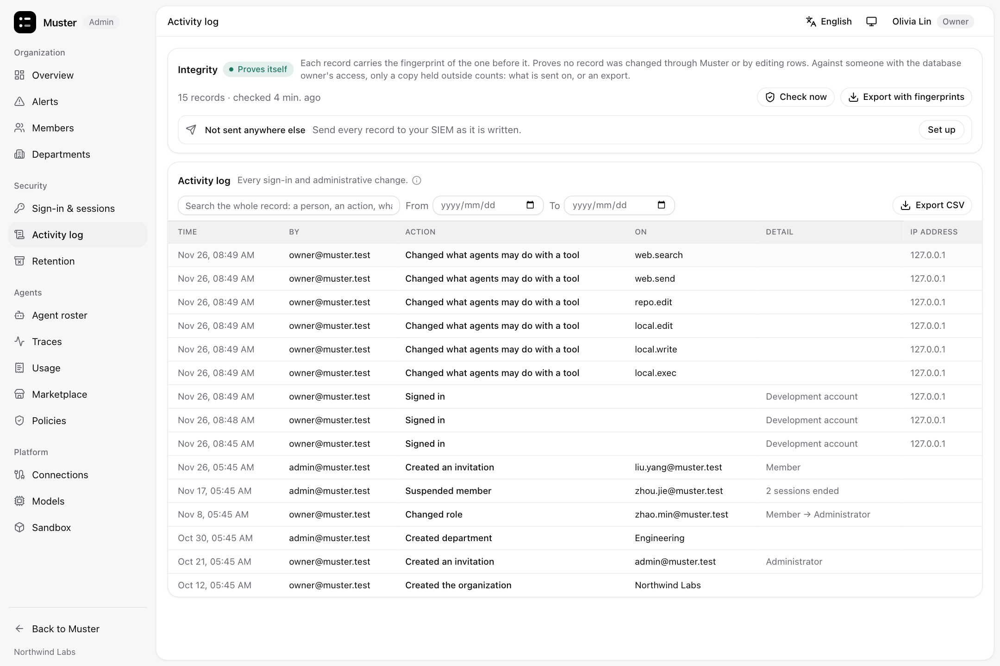

<p align="center">
  
</p>

<h1 align="center">Muster · 点兵</h1>

<p align="center">
  <b>The open-source agent workspace for the enterprise, with the control plane built in.</b><br>
  Every employee gets agents that do real office work.<br>
  The company gets a register, a gate and a record for every one of them.
</p>

<p align="center">
  <b>English</b> · <a href="README.zh-CN.md">简体中文</a>
</p>



## What it is

Putting agents to work in a company takes three things: something people use, something
the company governs with, and a runtime that can be held to rules. Muster is all three
in one repository, under one licence.

| | What you get | In the same space |
|---|---|---|
| **A workspace** for everyone | Web, a macOS desktop app, and an iOS app you build from source. Talk to agents, get replies as real interface (tables, forms, charts), keep documents and files, build agents of your own. | Tencent WorkBuddy |
| **A control plane** for the company | Every agent registered under its own identity and risk level. Approvals, a trace of every run, usage and cost, an append-only activity log, SSO (Google, Microsoft, OIDC, SAML) and SCIM. | Microsoft Agent 365 |
| **A governed runtime** | Built on OpenClaw's agent loop. Every tool call passes one gateway that allows it, asks the person first, or refuses. Code runs in a sandbox that reaches only the hosts an administrator allows. | Built on OpenClaw |

What makes it different: the agents and their governance are one system. Nothing an agent
does skips the gateway, and nothing in the admin console describes an agent that runs
somewhere you cannot see.

You host it. You choose the model: Anthropic, or anything that speaks OpenAI chat
completions, including one you run yourself.

## A look around

<table>
<tr>
<td width="50%" valign="top"><a href="docs/screens/workspace-start.png"></a><br><b>Start</b><br>Say what you need, drop in files, pick an agent. "Ask first" is how much it may do without asking.</td>
<td width="50%" valign="top"><a href="docs/screens/workspace-agents.png"></a><br><b>Agents</b><br>The agents your organization offers, what each can reach, and a button to build your own.</td>
</tr>
<tr>
<td width="50%" valign="top"><a href="docs/screens/admin-overview.png"></a><br><b>Overview</b><br>Runs, success rate, cost, people using agents, and what needs attention.</td>
<td width="50%" valign="top"><a href="docs/screens/admin-agents.png"></a><br><b>Agent roster</b><br>Every agent with its owner, risk level, state and last run. Approve, suspend, restore.</td>
</tr>
<tr>
<td width="50%" valign="top"><a href="docs/screens/admin-policies.png"></a><br><b>Policies</b><br>Each tool is allowed, asks the person first, or is off, for everyone or per department.</td>
<td width="50%" valign="top"><a href="docs/screens/admin-traces.png"></a><br><b>Traces</b><br>Every run: who, which agent, how long, how many tokens, what it cost, how it ended.</td>
</tr>
<tr>
<td width="50%" valign="top"><a href="docs/screens/admin-trace.png"></a><br><b>One run, step by step</b><br>Each decision, tool call and policy check of a run, with input and output.</td>
<td width="50%" valign="top"><a href="docs/screens/admin-usage.png"></a><br><b>Usage and budgets</b><br>Cost by department and person, with limits for the company and for each person.</td>
</tr>
<tr>
<td width="50%" valign="top"><a href="docs/screens/admin-audit.png"></a><br><b>Activity log</b><br>Every sign-in and administrative change, each record carrying the fingerprint of the one before.</td>
</tr>
</table>

Screens are of the sample organization that `pnpm dev` starts with.

## Try it

You need Node.js 22.12 or later and pnpm 11. Clone this repository, then:

```bash
pnpm install
```

```bash
pnpm dev
```

Open http://localhost:5173 and choose a development account; `owner@muster.test` can
open the admin console. Agents need a model: copy `.env.example` to `.env` and fill in
the `MUSTER_MODEL_*` lines.

## Run it for your company

One machine with Docker: the server (which also serves the web app), PostgreSQL and the
sandbox. It builds from source; released images are on GitHub's registry.

```bash
cp deploy/.env.example deploy/.env
```

Fill in `deploy/.env`: the address people will open, the first owner's email, a database
password and at least one way to sign in. Then:

```bash
docker compose -f deploy/compose.yaml --env-file deploy/.env up -d --build
```

Put a TLS-terminating proxy in front of port 7410. Running code needs gVisor in Docker.
Upgrading, backup, single sign-on and what to do when something is wrong are in
[`docs/runbook.md`](docs/runbook.md).

The desktop app is in [`apps/desktop`](apps/desktop/README.md) and the iOS app in
[`apps/mobile`](apps/mobile/README.md). Both ask for your server's address on first run.

## Where it stands

Muster is before 1.0. It runs end to end; settings,
database schema and APIs may still change between minor versions, and
[`CHANGELOG.md`](CHANGELOG.md) says when they do.

What it does not do yet: the registry covers agents built and run in Muster, not
agents that run somewhere else. Each feature's own limits are written down in
[`docs/features`](docs/features/README.md) under "what is not built".

## Questions people ask

- **Does anything leave our network?** What agents read goes to the model you chose;
  host the model yourself and it does not leave. Web search is off until you turn it on.
- **Which sign-in works?** Google, Microsoft, any OpenID Connect provider (Keycloak,
  Authing, Okta, Authentik), SAML 2.0, with SCIM 2.0 for provisioning. Not built: LDAP,
  WeCom, DingTalk and Feishu sign-in.
- **Which languages?** The interface is in English and Simplified Chinese.
- **How big can it go?** One server container per database, on one machine. There is no
  high-availability setup yet. Backup, upgrade and going back are in the runbook.

## Built on OpenClaw

Muster's agent loop is [OpenClaw](https://github.com/openclaw/openclaw)'s (MIT), taken
piece by piece at tag `v2026.9.8` into [`vendor/openclaw`](vendor/openclaw). This
repository is not a fork of OpenClaw's: three of its packages are here, with thanks,
and everything around them (the gateway, the sandbox, the control plane, the clients) is Muster's own.
What was taken, left out and changed is recorded line by line in
[`vendor/openclaw/UPSTREAM.md`](vendor/openclaw/UPSTREAM.md).

Muster is an independent project, not affiliated with the OpenClaw Foundation, Tencent
or Microsoft. WorkBuddy and Agent 365 are their owners' trademarks, named here only for
comparison.

## Layout

```
apps/server        the server: sign-in, people, agents, runs, approvals, traces
apps/web           the web app: the workspace and, under #/admin, the admin console
apps/desktop       the desktop app (Electron)
apps/mobile        the iOS app (Expo, outside the pnpm workspace)
apps/sandbox       runs agents' code, each run in a container of its own
packages/protocol  identity and audit-event definitions
packages/ui-schema the components an agent's reply may use (OpenUI)
vendor/openclaw    the parts of OpenClaw the runtime is built on
deploy/            compose file and environment example
docs/              locked decisions, feature descriptions, runbook
```

## Versions and releases

One version for the whole product, [semantic](https://semver.org): tags `vX.Y.Z`. Each
release has notes in [`CHANGELOG.md`](CHANGELOG.md), a container image and a GitHub
Release. How a release is made: [`docs/releasing.md`](docs/releasing.md).

## Contributing

Bugs and ideas: open an issue. Code: read [`CONTRIBUTING.md`](CONTRIBUTING.md);
`pnpm check` is what CI runs. A security problem: [`SECURITY.md`](SECURITY.md), not a
public issue.

## License

[Apache-2.0](LICENSE). Third-party notices are in [`NOTICE`](NOTICE).
